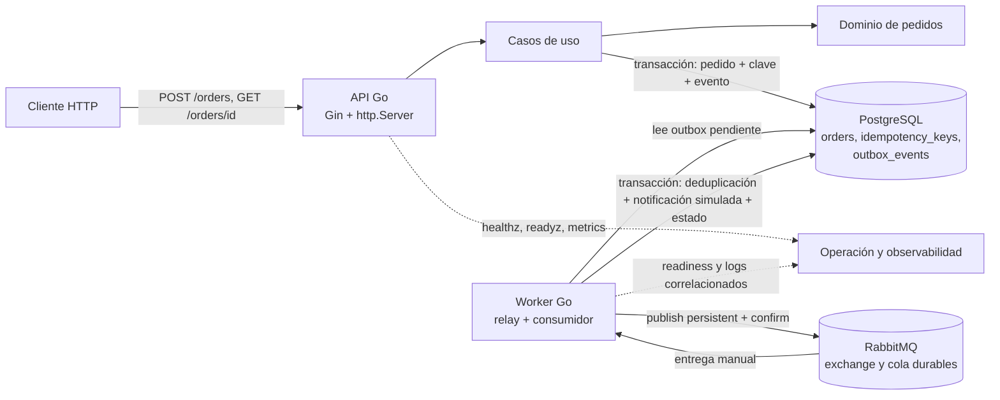

# Arquitectura de EventFlow

EventFlow es un servicio modular en Go que se ejecuta como dos procesos. La API depende de PostgreSQL, no de RabbitMQ. El worker contiene el relay de outbox y el consumidor; ambos procesos comparten módulos y contratos de aplicación.

## Flujo de creación y procesamiento

1. El handler valida JSON, `Idempotency-Key` y parámetros; el caso de uso aplica las reglas del dominio.
2. Una transacción PostgreSQL guarda pedido, artículos, clave idempotente con snapshot de respuesta y evento `order.created` en `outbox_events`. La API responde `201` cuando esa transacción confirma.
3. El relay reclama mensajes pendientes, publica con entrega persistente y publisher confirm, y marca el outbox publicado solo tras confirmación positiva y ruta válida.
4. El consumidor procesa el evento y persiste deduplicación, notificación simulada y transición de estado en PostgreSQL. Solo después de un resultado durable confirma el mensaje.
5. Un error transitorio programa una continuación durable en outbox. Si se agotan los cuatro intentos, persiste un registro terminal para investigación.

## Estructura del código

- `cmd/api`, `cmd/worker`, `cmd/migrate`: puntos de entrada de los procesos.
- `cmd/app`, `cmd/container`, `cmd/routes`: lifecycle y ensamblado de dependencias/rutas.
- `internal/order/domain`: entidades, invariantes y cálculo monetario.
- `internal/order/application`: DTO, eventos, puertos y casos de uso.
- `internal/order/infrastructure`: adaptadores PostgreSQL, relay y consumidor.
- `internal/order/presentation`: handlers HTTP y rutas del módulo.
- `internal/health`: liveness/readiness.
- `pkg`: configuración compartida de base de datos, errores, logging, métricas, correlación y mensajería.
- `migrations`: migraciones SQL versionadas y embebidas en el ejecutable migrador.

La separación API/worker es de procesos dentro del mismo repositorio; no implica microservicios desplegados de forma independiente.
